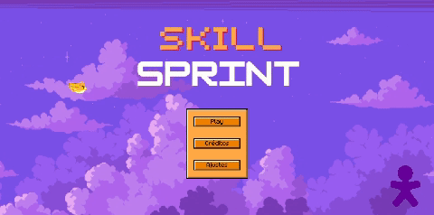
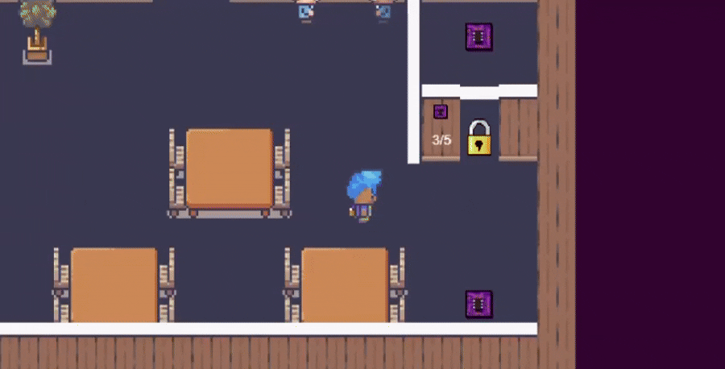

# Skill Sprint

Serious game sobre mobilidade interna, job rotation e desenvolvimento de carreira.

Projeto acadêmico desenvolvido em equipe no Inteli, em parceria com **Vivo — Telefônica Brasil**, no período de fev–abr/2025.

## Interface

Tela inicial do jogo registrada na documentação da Sprint 4. O registro ilustra a identidade visual dessa etapa e não comprova, por si só, a versão final da entrega.

### Gameplay

Registro de gameplay preservado no material do projeto, mostrando uma das fases em ambiente de escritório. O trecho ilustra o trabalho coletivo da equipe; não atribui a autoria específica desta fase a mim.

## Contexto e proposta

Programas de desenvolvimento de carreira podem ser difíceis de comunicar de forma acessível e envolvente. O Skill Sprint transforma temas como mobilidade interna e aprendizado de novas competências em uma jornada interativa, aproximando esses conceitos de situações exploráveis pelo jogador.

## Minha participação

Projetei duas das cinco fases gamificadas e contribuí para o desenvolvimento em Phaser.js. Iterei a experiência com base em avaliações de usuários e do parceiro.

A solução completa é resultado do trabalho coletivo da equipe.

## Pontos técnicos e aprendizados

- **Mecânicas com propósito:** os desafios precisam se relacionar ao objetivo de aprendizagem, além de oferecer entretenimento.
- **Clareza e inclusão:** personagens e interações fazem parte da forma como diferentes pessoas se reconhecem e compreendem a experiência.
- **Iteração com feedback:** testar a experiência com usuários e com o parceiro ajuda a ajustar a compreensão das fases e o ritmo da jornada.

## Tecnologias

JavaScript · Phaser.js · Game Design · Testes de usabilidade.

## Sobre este repositório

Este repositório reúne uma apresentação resumida do Skill Sprint e da minha participação no desenvolvimento; não contém a documentação completa do projeto. O código-fonte, o histórico e a documentação completa são mantidos privados porque o projeto foi desenvolvido em um ambiente acadêmico controlado do Inteli, em parceria com **Vivo — Telefônica Brasil**, respeitando o contexto de compartilhamento dessa colaboração.

Em conversas e processos seletivos, fico à disposição para comentar minha participação, as decisões técnicas e os aprendizados do projeto, apresentar e discutir a documentação completa e demonstrar o código, respeitando os limites de compartilhamento das informações.
